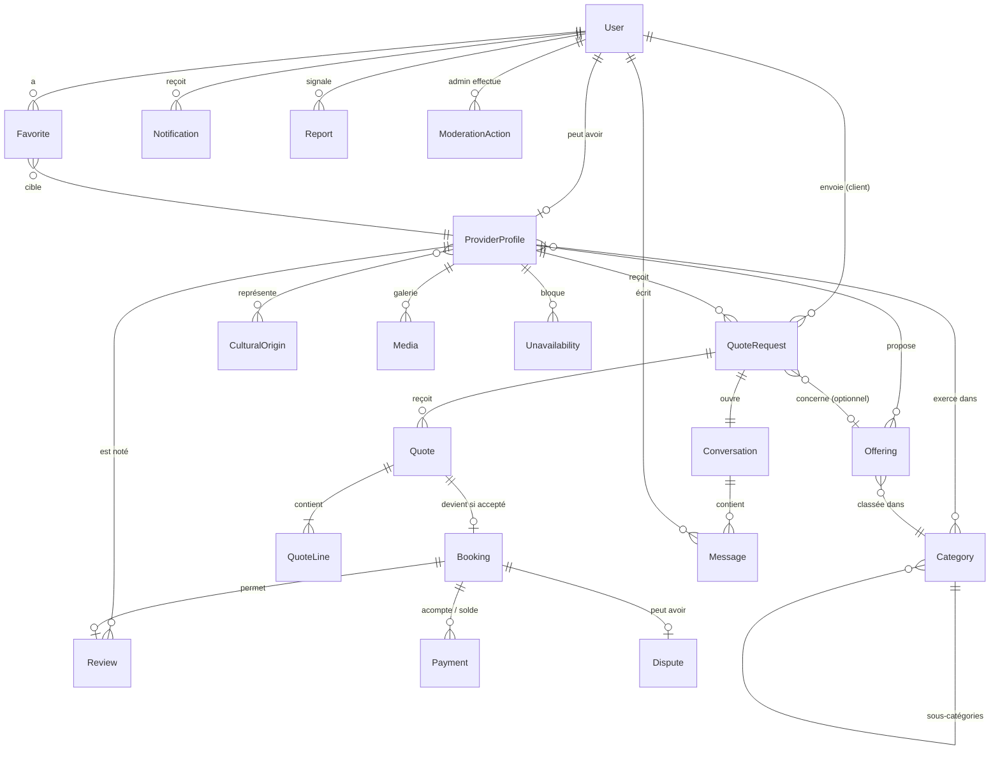
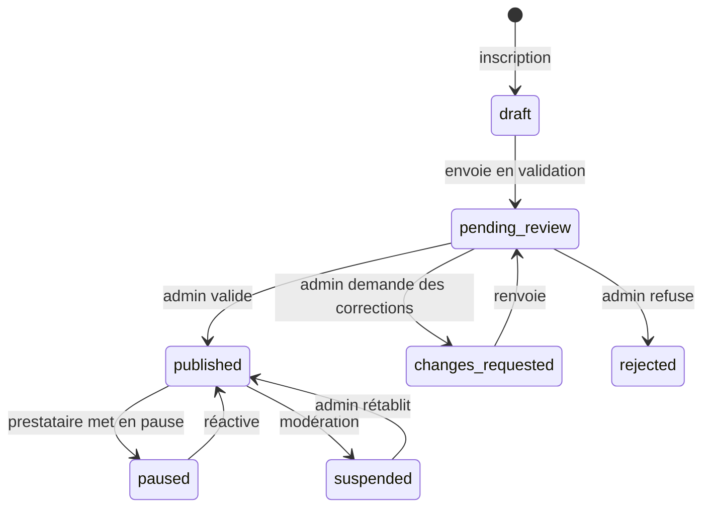
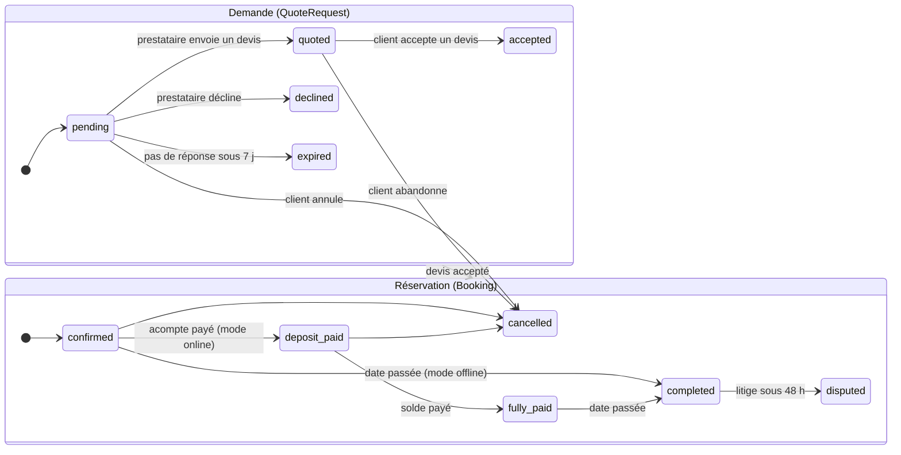

# Étape 2 : Modèle de données

Marketplace de prestataires afro. Version 1, 22 novembre 2026.
Basé sur [les parcours utilisateurs](1-parcours-utilisateurs.md) et les décisions validées par Mouss.

---

## 0. Rappel des décisions qui façonnent ce modèle

| Décision                                                  | Conséquence dans les données                                                                                                   |
| --------------------------------------------------------- | ------------------------------------------------------------------------------------------------------------------------------ |
| Un compte, deux rôles                                     | Une seule entité `User`. Le côté prestataire est un `ProviderProfile` rattaché (0 ou 1 par user)                               |
| Devis d'abord, réservation directe en V2                  | Chaîne `QuoteRequest` → `Quote` → `Booking`. Les `Offering` ont déjà un champ « prix fixe » pour préparer la V2                |
| Une demande = un seul prestataire                         | `QuoteRequest` pointe vers **un** prestataire                                                                                  |
| Paiement hors plateforme au début, Stripe Connect ensuite | `Booking.paymentMode` = `offline` ou `online`. L'entité `Payment` existe dès maintenant mais n'est remplie qu'en mode `online` |
| Gratuit puis commission + mise en avant payante           | `Booking.commissionRate` (0 au lancement), `ProviderProfile.featuredUntil`                                                     |
| Coordonnées masquées avant réservation                    | `Message.hasMaskedContent` (le filtrage se fait au moment de l'envoi)                                                          |
| SIRET facultatif + badge                                  | `ProviderProfile.siret` optionnel, `isProVerified`                                                                             |
| Plusieurs prestations par jour via un réglage             | `ProviderProfile.maxBookingsPerDay` (1 par défaut)                                                                             |
| Clients pros plus tard                                    | `QuoteRequest.clientType` = `individual` ou `business` dès maintenant                                                          |
| Lancement Île-de-France                                   | Rien de spécial : on stocke ville, code postal et coordonnées GPS, ce qui marche partout                                       |

---

## 1. Comment lire ce document

- Une **entité** est un type d'objet que l'application manipule (un utilisateur, un devis…). Plus tard, ce sera un type TypeScript dans `packages/common`, et une table en base de données quand le vrai back-end arrivera.
- Un **champ** est une propriété de l'entité. `?` signifie facultatif.
- Une **relation** dit comment les entités sont liées : « un prestataire a plusieurs prestations ». On la stocke avec un identifiant : la prestation contient `providerId`.
- Un **statut** est une valeur parmi une liste fixe qui dit où en est un objet (une demande est `pending`, puis `quoted`…). Les statuts sont le cœur de la logique métier : ils décident quels boutons s'affichent et quelles actions sont permises.

Conventions communes à toutes les entités :

- `id` : identifiant unique (chaîne de type UUID).
- `createdAt`, `updatedAt` : dates au format ISO (`2026-11-22T10:00:00Z`). Je ne les répète pas dans les tableaux.
- **Montants en centimes** (entier) : `90000` = 900,00 €. Ça évite les erreurs d'arrondi des nombres à virgule.
- Noms de champs en anglais (c'est la norme dans le code), explications en français.

---

## 2. Vue d'ensemble

Le modèle se découpe en 5 blocs :

1. **Comptes** : User, ProviderProfile
2. **Catalogue** : Category, CulturalOrigin, Offering, Media, Unavailability
3. **Transaction** : QuoteRequest, Quote, QuoteLine, Booking, Payment
4. **Échanges** : Conversation, Message, Review, Favorite, Notification
5. **Modération** : Report, Dispute, ModerationAction

Lecture des symboles : `||` = exactement un, `o|` = zéro ou un, `o{` = zéro ou plusieurs, `|{` = un ou plusieurs.

---

## 3. Bloc Comptes

### User

Toute personne inscrite : client, prestataire (via son profil), ou admin.

| Champ               | Type                                          | Explication                                                   |
| ------------------- | --------------------------------------------- | ------------------------------------------------------------- |
| email               | texte                                         | Unique, sert à la connexion                                   |
| firstName, lastName | texte                                         |                                                               |
| phone?              | texte                                         | Jamais affiché aux autres avant une réservation               |
| avatarUrl?          | texte                                         |                                                               |
| roles               | liste de `client` / `provider` / `admin`      | Un compte peut cumuler. Tout le monde est `client` par défaut |
| authProvider        | `email` / `google` / `apple`                  |                                                               |
| status              | `active` / `suspended` / `banned` / `deleted` | `deleted` = anonymisé (RGPD) sans casser l'historique         |
| notificationPrefs   | objet (email, push, sms : oui/non par type)   |                                                               |

### ProviderProfile

La « vitrine » d'un prestataire. Existe seulement si le user a le rôle `provider`.

| Champ                      | Type                                     | Explication                                                           |
| -------------------------- | ---------------------------------------- | --------------------------------------------------------------------- |
| userId                     | → User                                   | Le propriétaire (relation 1 à 1)                                      |
| displayName                | texte                                    | Nom commercial (« Saveurs de Dakar »)                                 |
| slug                       | texte                                    | Pour l'URL : `/prestataires/saveurs-de-dakar` (bon pour Google)       |
| bio                        | texte long                               |                                                                       |
| coverUrl?                  | texte                                    |                                                                       |
| legalType                  | `individual` / `company` / `association` |                                                                       |
| siret?                     | texte                                    | Facultatif                                                            |
| isProVerified              | booléen                                  | Badge « pro vérifié », mis à `true` par un admin si SIRET contrôlé    |
| categoryIds                | liste → Category                         | Sous-catégories exercées                                              |
| culturalOriginIds          | liste → CulturalOrigin                   |                                                                       |
| languages                  | liste de textes                          | fr, en, wolof, lingala…                                               |
| city, postalCode           | texte                                    |                                                                       |
| location                   | `{ lat, lng }`                           | Pour la distance et la carte                                          |
| travelRadiusKm             | nombre                                   | Distance de déplacement acceptée                                      |
| priceFrom?                 | centimes                                 | « À partir de », calculé depuis les offres, pour le filtre budget     |
| maxBookingsPerDay          | nombre                                   | 1 par défaut                                                          |
| cancellationPolicy         | `flexible` / `moderate` / `strict`       |                                                                       |
| status                     | voir ci-dessous                          |                                                                       |
| rejectionReason?           | texte                                    | Message de l'admin si corrections demandées                           |
| onboardingStep             | nombre                                   | Pour reprendre l'onboarding là où il s'est arrêté                     |
| ratingAverage, ratingCount | nombres                                  | Recalculés à chaque avis (évite de tout recompter à chaque affichage) |
| responseTimeHours?         | nombre                                   | Temps de réponse moyen, calculé                                       |
| featuredUntil?             | date                                     | Mise en avant payante (V2)                                            |
| stripeAccountId?           | texte                                    | Quand le paiement en ligne arrive                                     |

**Statuts du profil**

Seuls les profils `published` apparaissent dans la recherche.

---

## 4. Bloc Catalogue

### Category

Catégories et sous-catégories dans la même entité, grâce à `parentId`.

| Champ     | Type       | Explication                                                                |
| --------- | ---------- | -------------------------------------------------------------------------- |
| name      | texte      | « Traiteur », « Danse »                                                    |
| slug      | texte      | Pour l'URL `/traiteurs`                                                    |
| parentId? | → Category | Vide = catégorie principale. Ex. « Traiteur » a pour parent « Nourriture » |
| icon?     | texte      |                                                                            |
| order     | nombre     | Ordre d'affichage                                                          |

Exemple : Nourriture › Traiteur, Pâtisserie, Food truck · Spectacle › Danse, Musique live, DJ, Humour · Conférence › Speaker, Animateur · Beauté › Coiffure, Maquillage · Décoration › Décoration de salle, Location de tenues.

### CulturalOrigin

| Champ   | Type  | Explication                                                            |
| ------- | ----- | ---------------------------------------------------------------------- |
| name    | texte | « Sénégal », « Côte d'Ivoire », « Antilles »                           |
| slug    | texte |                                                                        |
| region? | texte | « Afrique de l'Ouest », « Caraïbes » : pour regrouper dans les filtres |

Séparée des catégories car c'est un **filtre transversal** : on veut « traiteur » **et** « ivoirien ».

### Offering (prestation / formule)

| Champ                  | Type                                         | Explication                                    |
| ---------------------- | -------------------------------------------- | ---------------------------------------------- |
| providerId             | → ProviderProfile                            |                                                |
| categoryId             | → Category                                   |                                                |
| title                  | texte                                        | « Buffet mariage 50 personnes »                |
| description            | texte                                        |                                                |
| pricingType            | `from` / `fixed` / `per_person` / `on_quote` | `fixed` servira à la réservation directe en V2 |
| price?                 | centimes                                     | Vide si `on_quote`                             |
| durationMinutes?       | nombre                                       | Pour les shows                                 |
| minGuests?, maxGuests? | nombres                                      | Pour les traiteurs                             |
| isActive               | booléen                                      |                                                |

### Media

| Champ              | Type              | Explication |
| ------------------ | ----------------- | ----------- |
| providerId         | → ProviderProfile |             |
| type               | `image` / `video` |             |
| url, thumbnailUrl? | texte             |             |
| caption?           | texte             |             |
| order              | nombre            |             |

Règle : minimum 3 images pour passer en `pending_review`.

### Unavailability (dates bloquées)

On ne stocke **que les indisponibilités**, pas les disponibilités : par défaut, un prestataire est disponible. C'est beaucoup plus simple.

| Champ      | Type                 | Explication                                           |
| ---------- | -------------------- | ----------------------------------------------------- |
| providerId | → ProviderProfile    |                                                       |
| date       | date (jour)          |                                                       |
| reason     | `manual` / `booking` | `booking` = créée automatiquement par une réservation |
| bookingId? | → Booking            |                                                       |

Un prestataire est **indisponible** un jour donné si il a un blocage `manual`, ou si le nombre de réservations ce jour-là atteint `maxBookingsPerDay`.

---

## 5. Bloc Transaction (le cœur)

Le chemin complet : **Demande → Devis → Réservation → (Paiement) → Avis**.

### QuoteRequest (demande de devis)

| Champ                      | Type                                                                   | Explication                                       |
| -------------------------- | ---------------------------------------------------------------------- | ------------------------------------------------- |
| clientId                   | → User                                                                 |                                                   |
| providerId                 | → ProviderProfile                                                      | Un seul prestataire (décision n°3)                |
| offeringId?                | → Offering                                                             | Si le client part d'une formule précise           |
| clientType                 | `individual` / `business`                                              | Préparé pour les clients pros                     |
| eventType                  | `wedding` / `birthday` / `baptism` / `corporate` / `funeral` / `other` |                                                   |
| eventDate                  | date                                                                   |                                                   |
| eventCity, eventPostalCode | texte                                                                  | Adresse précise seulement après réservation       |
| guestCount?                | nombre                                                                 |                                                   |
| budgetMin?, budgetMax?     | centimes                                                               |                                                   |
| message                    | texte                                                                  |                                                   |
| status                     | voir ci-dessous                                                        |                                                   |
| declineReason?             | texte                                                                  |                                                   |
| expiresAt                  | date                                                                   | Expiration automatique sans réponse (ex. 7 jours) |

### Quote (devis) et QuoteLine (lignes du devis)

Une demande peut recevoir **plusieurs versions** de devis (après négociation). Une seule peut être acceptée.

**Quote**

| Champ          | Type                                                        | Explication                                          |
| -------------- | ----------------------------------------------------------- | ---------------------------------------------------- |
| quoteRequestId | → QuoteRequest                                              |                                                      |
| version        | nombre                                                      | 1, 2, 3…                                             |
| totalAmount    | centimes                                                    | Somme des lignes                                     |
| depositRate    | pourcentage                                                 | Ex. 30 %                                             |
| validUntil     | date                                                        |                                                      |
| conditions?    | texte                                                       |                                                      |
| status         | `sent` / `accepted` / `declined` / `expired` / `superseded` | `superseded` = remplacé par une version plus récente |

**QuoteLine**

| Champ     | Type                                       |
| --------- | ------------------------------------------ |
| quoteId   | → Quote                                    |
| label     | texte (« Plat principal : thiéboudienne ») |
| quantity  | nombre                                     |
| unitPrice | centimes                                   |

### Booking (réservation)

Créée automatiquement quand le client accepte un devis.

| Champ                       | Type                                                      | Explication                                                                                   |
| --------------------------- | --------------------------------------------------------- | --------------------------------------------------------------------------------------------- |
| quoteId                     | → Quote                                                   | Le devis accepté                                                                              |
| clientId, providerId        | → User, → ProviderProfile                                 | Copiés pour faciliter les recherches                                                          |
| eventDate                   | date                                                      |                                                                                               |
| eventAddress                | texte                                                     | Révélée aux deux parties maintenant                                                           |
| totalAmount, depositAmount  | centimes                                                  | Copiés du devis (le devis ne doit plus bouger)                                                |
| paymentMode                 | `offline` / `online`                                      | `offline` au lancement                                                                        |
| commissionRate              | pourcentage                                               | 0 au lancement                                                                                |
| cancellationPolicy          | copie de celle du prestataire au moment de la réservation | Si le prestataire change sa politique plus tard, ça ne change pas les réservations existantes |
| status                      | voir ci-dessous                                           |                                                                                               |
| cancelledBy?, cancelReason? |                                                           |                                                                                               |

**Pourquoi copier des valeurs ?** Une réservation est un engagement figé. Si le prestataire modifie son prix ou sa politique demain, la réservation d'hier ne doit pas changer.

### Payment (préparé, utilisé quand Stripe arrive)

| Champ                  | Type                                            | Explication                                                   |
| ---------------------- | ----------------------------------------------- | ------------------------------------------------------------- |
| bookingId              | → Booking                                       |                                                               |
| kind                   | `deposit` / `balance` / `refund`                |                                                               |
| amount                 | centimes                                        |                                                               |
| status                 | `pending` / `succeeded` / `failed` / `refunded` |                                                               |
| stripePaymentIntentId? | texte                                           |                                                               |
| payoutStatus           | `held` / `released` / `frozen`                  | Argent retenu, versé au prestataire, ou gelé en cas de litige |

### Le cycle de vie complet

En mode `offline` (lancement), la réservation passe directement de `confirmed` à `completed` après la date : pas d'étapes de paiement.

---

## 6. Bloc Échanges

### Conversation

Une conversation par demande de devis (décision : messagerie liée à la demande).

| Champ                                  | Type           | Explication              |
| -------------------------------------- | -------------- | ------------------------ |
| quoteRequestId                         | → QuoteRequest |                          |
| clientId, providerUserId               | → User         | Les deux participants    |
| lastMessageAt                          | date           | Pour trier la liste      |
| unreadCountClient, unreadCountProvider | nombres        | Pour le badge « non lu » |

### Message

| Champ            | Type                             | Explication                                                           |
| ---------------- | -------------------------------- | --------------------------------------------------------------------- |
| conversationId   | → Conversation                   |                                                                       |
| senderId         | → User                           |                                                                       |
| kind             | `text` / `attachment` / `system` | `system` = message auto (« Devis envoyé », « Réservation confirmée ») |
| body             | texte                            |                                                                       |
| attachments?     | liste `{ url, name, mimeType }`  |                                                                       |
| hasMaskedContent | booléen                          | `true` si un téléphone ou email a été masqué (avant réservation)      |
| readAt?          | date                             |                                                                       |

### Review (avis)

| Champ                              | Type                              | Explication                                                       |
| ---------------------------------- | --------------------------------- | ----------------------------------------------------------------- |
| bookingId                          | → Booking                         | Unique : **un avis par réservation**, et seulement si `completed` |
| authorId                           | → User                            |                                                                   |
| providerId                         | → ProviderProfile                 |                                                                   |
| rating                             | 1 à 5                             |                                                                   |
| subRatings?                        | `{ quality, punctuality, value }` |                                                                   |
| comment?                           | texte                             |                                                                   |
| photos?                            | liste d'URL                       |                                                                   |
| providerReply?, providerRepliedAt? |                                   | Une seule réponse publique                                        |
| status                             | `published` / `hidden`            | `hidden` par modération                                           |

### Favorite

`userId` → User, `providerId` → ProviderProfile. Rien d'autre.

### Notification

| Champ   | Type                                                                                                                    | Explication                        |
| ------- | ----------------------------------------------------------------------------------------------------------------------- | ---------------------------------- |
| userId  | → User                                                                                                                  |                                    |
| type    | `new_request` / `new_quote` / `new_message` / `booking_confirmed` / `reminder` / `review_invite` / `profile_validated`… |                                    |
| payload | objet                                                                                                                   | Ids utiles pour construire le lien |
| readAt? | date                                                                                                                    |                                    |

---

## 7. Bloc Modération

### Report (signalement)

| Champ      | Type                                                         | Explication                                                                         |
| ---------- | ------------------------------------------------------------ | ----------------------------------------------------------------------------------- |
| reporterId | → User                                                       |                                                                                     |
| targetType | `provider` / `review` / `message` / `media` / `user`         |                                                                                     |
| targetId   | id                                                           | L'objet signalé (relation « polymorphe » : le type dit dans quelle entité chercher) |
| reason     | `fraud` / `inappropriate` / `spam` / `fake_review` / `other` |                                                                                     |
| details?   | texte                                                        |                                                                                     |
| status     | `open` / `resolved` / `dismissed`                            |                                                                                     |

### Dispute (litige)

| Champ           | Type                                             | Explication |
| --------------- | ------------------------------------------------ | ----------- |
| bookingId       | → Booking                                        |             |
| openedBy        | → User                                           |             |
| reason, details |                                                  |             |
| status          | `open` / `resolved`                              |             |
| resolution?     | `full_payout` / `partial_refund` / `full_refund` |             |
| refundAmount?   | centimes                                         |             |

Surtout utile en mode `online`. En mode `offline`, on garde au moins la trace des conflits.

### ModerationAction (journal admin)

| Champ                | Type                                                                                                                          | Explication |
| -------------------- | ----------------------------------------------------------------------------------------------------------------------------- | ----------- |
| adminId              | → User                                                                                                                        |             |
| action               | `validate_profile` / `request_changes` / `reject_profile` / `hide_content` / `suspend_user` / `ban_user` / `resolve_dispute`… |             |
| targetType, targetId |                                                                                                                               |             |
| note?                | texte                                                                                                                         |             |

Ce journal n'est jamais modifié ni supprimé : il sert de preuve en cas de contestation.

---

## 8. Règles métier importantes (à tester)

Ces règles sont de bons candidats pour tes tests unitaires (Vitest) :

1. Un user sans rôle `provider` ne peut pas avoir de `ProviderProfile`.
2. Un profil ne passe en `pending_review` que si : au moins 1 catégorie, 3 images, 1 offre active, une ville.
3. On ne peut pas envoyer une demande à un prestataire indisponible à la date demandée.
4. Un client ne peut pas s'envoyer une demande à lui-même (cas du compte à deux rôles).
5. Accepter un devis : passe les autres versions en `superseded`, crée la `Booking`, crée l'`Unavailability`, poste un message `system`.
6. Un avis n'est possible que sur une `Booking` `completed`, une seule fois, par le client de cette réservation.
7. Les téléphones et emails sont masqués dans les messages tant qu'il n'y a pas de réservation confirmée.
8. `ratingAverage` et `ratingCount` sont recalculés à chaque avis publié ou masqué.
9. Le remboursement d'une annulation dépend de la `cancellationPolicy` copiée dans la réservation et du nombre de jours avant l'événement.

---

## 9. Comment ça se traduit dans `packages/common`

Sans écrire de code encore, voici l'organisation prévue (détaillée à l'étape 3) :

- **`types/`** : un type TypeScript par entité de ce document (`User`, `ProviderProfile`, `QuoteRequest`…), et un type par liste de statuts (`BookingStatus`…). Le web et le mobile importent exactement les mêmes types.
- **`schemas/`** : la même chose sous forme de schémas de validation (Zod recommandé). Avantage : on écrit le schéma une fois, on en **déduit** le type TypeScript, et on s'en sert pour valider les formulaires côté web et mobile. Un seul endroit à maintenir.
- **`rules/`** : les règles métier de la section 8 sous forme de fonctions pures (« ce prestataire est-il disponible ce jour-là ? »). Faciles à tester, partagées web + mobile.
- **`api/`** : l'interface du client API (« récupérer les prestataires », « envoyer une demande »…). Au début elle est servie par MSW avec des données mockées ; plus tard par le vrai back-end, sans changer les écrans.
- **`mocks/`** : les données de test (une vingtaine de prestataires d'Île-de-France, quelques demandes dans chaque statut) et les handlers MSW.

Point d'attention : les types partagés décrivent les données **telles que l'API les renvoie**. Certaines vues auront des versions enrichies (ex. une `ProviderCard` pour les résultats de recherche, avec seulement nom, photo, note, prix « à partir de »). On les définira à l'étape 3.

---

## 10. Ce qui est volontairement laissé de côté (V2+)

- Réservation directe (prévue : `Offering.pricingType = fixed`)
- Abonnement prestataire et factures de la plateforme
- Codes promo, parrainage
- Synchronisation Google Calendar
- Multi-envoi d'une demande à plusieurs prestataires
- Équipes chez un prestataire (plusieurs users gérant un même profil)
- Traductions multilingues du contenu

Aucune de ces évolutions ne demande de casser ce modèle : on ajoutera des entités ou des champs.

---

## 11. Prochaine étape

**Étape 3, architecture technique** : structure du monorepo (apps/web, apps/mobile, packages/common), outils (pnpm workspaces ou Turborepo), routage, gestion d'état et des appels API (TanStack Query recommandé), MSW, organisation des tests, et choix du futur back-end.
