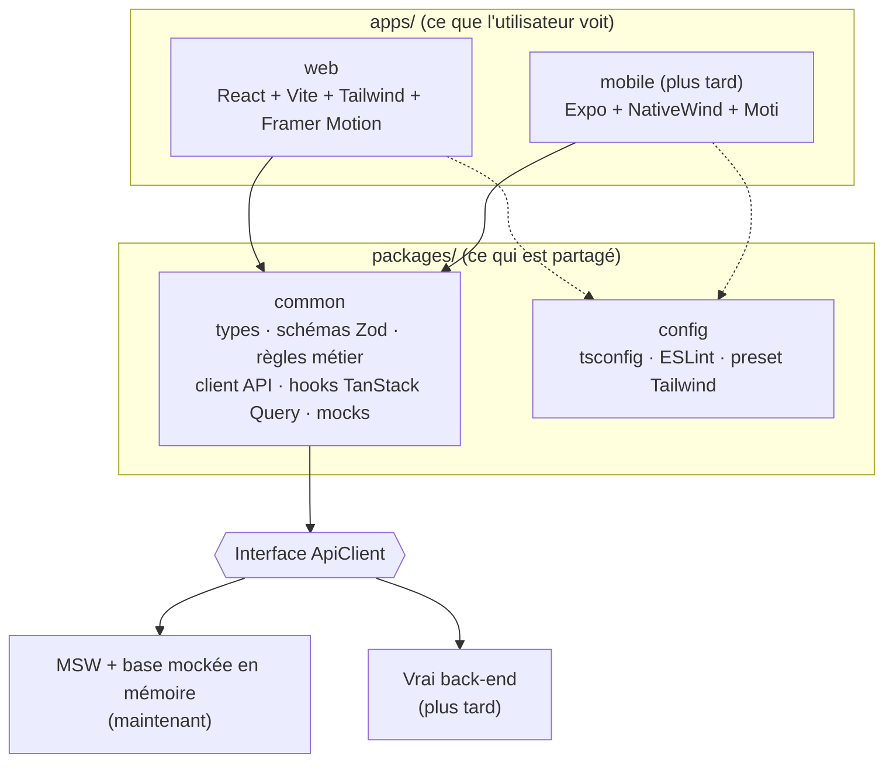
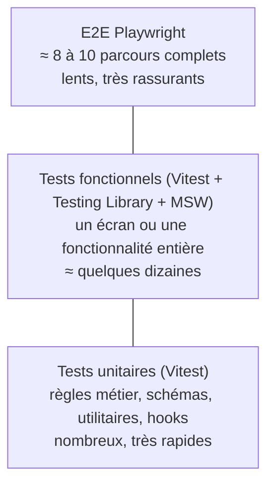

# Étape 3 : Architecture technique

Marketplace de prestataires afro. Version 1, 22 novembre 2026.
S'appuie sur [les parcours utilisateurs](1-parcours-utilisateurs.md) et [le modèle de données](2-modele-de-donnees.md).

---

## 0. L'idée générale en une image



**Le principe clé** : les écrans ne savent jamais d'où viennent les données. Ils appellent des hooks (`useProviders()`, `useSendQuoteRequest()`) qui passent par un client API. Aujourd'hui ce client parle à MSW (de fausses réponses), demain à un vrai serveur. On remplace le back-end sans toucher aux écrans.

---

## 1. Le monorepo

### Pourquoi un monorepo ?

Un seul dépôt Git qui contient plusieurs projets (le site web, l'app mobile, le code partagé). Avantages : un changement dans un type partagé est visible immédiatement dans le web et le mobile, une seule PR, une seule CI.

### Les outils

- **pnpm workspaces** : gère les dépendances et permet à `apps/web` d'importer `@afro/common` comme si c'était un paquet npm, alors qu'il est juste à côté. pnpm est rapide et économe en disque.
- **Turborepo** : lance les tâches (`build`, `test`, `lint`) dans le bon ordre entre les projets, en parallèle, et **met en cache** les résultats : si `common` n'a pas changé, ses tests ne sont pas relancés.

(Le nom `@afro/…` est provisoire, on le remplacera par le nom de la marque.)

### Arborescence

```
afro-marketplace/
├── apps/
│   ├── web/                      # Site web (client + prestataire + admin)
│   │   ├── public/
│   │   │   └── mockServiceWorker.js   # Généré par MSW
│   │   ├── src/
│   │   │   ├── app/              # Démarrage : routeur, providers, layouts
│   │   │   ├── features/         # Une dossier par fonctionnalité (voir §3)
│   │   │   ├── components/       # Composants UI génériques (Button, Modal, Card…)
│   │   │   ├── lib/              # Petits utilitaires propres au web
│   │   │   └── main.tsx
│   │   ├── e2e/                  # Tests Playwright
│   │   ├── index.html
│   │   ├── vite.config.ts
│   │   └── package.json
│   └── mobile/                   # Plus tard (Expo)
├── packages/
│   ├── common/
│   │   ├── src/
│   │   │   ├── types/            # Types déduits des schémas
│   │   │   ├── schemas/          # Schémas Zod (une entité = un fichier)
│   │   │   ├── rules/            # Règles métier (fonctions pures)
│   │   │   ├── api/              # Interface ApiClient + implémentation HTTP
│   │   │   ├── queries/          # Hooks TanStack Query partagés web/mobile
│   │   │   ├── mocks/            # Données de test, base mémoire, handlers MSW
│   │   │   └── utils/            # Formatage prix, dates…
│   │   └── package.json
│   └── config/
│       ├── tsconfig/             # Réglages TypeScript communs (strict)
│       ├── eslint/               # Règles ESLint communes
│       └── tailwind/             # Preset Tailwind : couleurs, polices, espacements de la marque
├── .github/workflows/ci.yml
├── turbo.json
├── pnpm-workspace.yaml
└── package.json
```

**Pourquoi séparer `common` et `config` ?** `common` contient du code qui tourne dans l'application (il est embarqué dans le site). `config` contient des réglages d'outils qui ne servent qu'au développement. Les séparer évite qu'une app mobile embarque par erreur des outils de build. Le **preset Tailwind** est dans `config` et sera utilisé à la fois par Tailwind (web) et par NativeWind (mobile) : mêmes couleurs, même typographie partout.

---

## 2. `packages/common` en détail

C'est le cerveau partagé. Il ne contient **aucun composant visuel** (un bouton web et un bouton mobile ne sont pas faits pareil), seulement de la logique.

| Dossier    | Contenu                                                                                                                                        | Exemple                                                                                                   |
| ---------- | ---------------------------------------------------------------------------------------------------------------------------------------------- | --------------------------------------------------------------------------------------------------------- |
| `schemas/` | Un schéma Zod par entité de l'étape 2, et pour chaque formulaire                                                                               | `quoteRequestSchema`, `createQuoteRequestInputSchema`                                                     |
| `types/`   | Types TypeScript **déduits** des schémas (`z.infer`) : on n'écrit jamais deux fois la même chose                                               | `QuoteRequest`, `BookingStatus`                                                                           |
| `rules/`   | Les 9 règles métier de l'étape 2, en fonctions pures (pas d'appel réseau, pas d'état)                                                          | `isProviderAvailable(provider, bookings, date)`, `canLeaveReview(booking, user)`, `maskContactInfo(text)` |
| `api/`     | L'**interface** `ApiClient` (liste de toutes les opérations) + une implémentation qui fait des `fetch` vers une URL                            | `searchProviders(filters)`, `sendQuoteRequest(input)`, `acceptQuote(id)`                                  |
| `queries/` | Hooks TanStack Query bâtis sur l'ApiClient, + les « clés de cache »                                                                            | `useProviderSearch(filters)`, `useAcceptQuote()`                                                          |
| `mocks/`   | Jeu de données réaliste (≈ 25 prestataires en Île-de-France, des demandes dans chaque statut), une petite base en mémoire, et les handlers MSW | `seed.ts`, `db.ts`, `handlers/`                                                                           |
| `utils/`   | Formatage                                                                                                                                      | `formatPrice(90000)` → « 900 € »                                                                          |

**Pourquoi Zod ?** Un schéma Zod sert à trois choses à la fois : le **type** TypeScript, la **validation des formulaires** (avec React Hook Form), et la **validation des réponses de l'API** (si le serveur renvoie n'importe quoi, on le voit tout de suite). Un seul endroit à modifier.

**Les règles métier vivent dans `common`, pas dans les composants.** Exemple : le bouton « Laisser un avis » s'affiche si `canLeaveReview(booking, user)` renvoie `true`. Le jour où on aura un vrai back-end, il appliquera la même règle (et s'il est en TypeScript, il pourra même importer la même fonction).

---

## 3. L'application web

### 3.1 Organisation par fonctionnalité

Plutôt que de ranger par type de fichier (tous les composants ensemble, tous les hooks ensemble), on range **par fonctionnalité**. Tout ce qui concerne la recherche est dans `features/search/`. C'est plus facile de s'y retrouver quand l'app grandit.

```
src/features/
├── auth/              # Connexion, inscription, session
├── search/            # Accueil, résultats, filtres, page catégorie
├── provider-profile/  # Page publique d'un prestataire
├── quote-requests/    # Formulaire de demande, liste et détail (côté client et prestataire)
├── quotes/            # Création et affichage d'un devis
├── bookings/          # Réservations
├── messaging/         # Liste de conversations, fil de messages
├── reviews/           # Laisser / afficher / répondre à un avis
├── provider-onboarding/
├── provider-dashboard/  # Tableau de bord, agenda, édition du profil
├── account/           # Mon compte, favoris
└── admin/             # Validation, signalements, utilisateurs
```

Chaque dossier contient ses `pages/`, `components/` et éventuellement des hooks propres. Règle simple : une fonctionnalité peut importer `components/` (UI générique) et `@afro/common`, mais **évite d'importer une autre fonctionnalité**. Si deux fonctionnalités partagent quelque chose, on le remonte dans `components/` ou `common`.

### 3.2 Routage

Recommandation : **React Router (v7, mode « data »)**. C'est le plus répandu, très documenté, et tu le connais sans doute déjà. (Alternative : TanStack Router, mieux typé mais plus récent ; inutile de cumuler les nouveautés.)

Les pages sont **chargées à la demande** (lazy loading) : l'espace admin n'est téléchargé que par les admins.

| URL                                                        | Page                                   | Accès       |
| ---------------------------------------------------------- | -------------------------------------- | ----------- |
| `/`                                                        | Accueil                                | Public      |
| `/recherche?cat=…&origine=…&ville=…&date=…`                | Résultats                              | Public      |
| `/categories/:slug` (ex. `/categories/traiteurs`)          | Page catégorie                         | Public      |
| `/prestataires/:slug`                                      | Profil prestataire                     | Public      |
| `/prestataires/:slug/demande`                              | Formulaire de devis                    | Connecté    |
| `/devenir-prestataire`                                     | Présentation                           | Public      |
| `/connexion`, `/inscription`                               | Auth                                   | Public      |
| `/compte/demandes`, `/compte/demandes/:id`                 | Mes demandes et réservations           | Client      |
| `/compte/messages`, `/compte/messages/:id`                 | Messagerie                             | Client      |
| `/compte/favoris`, `/compte/profil`                        | Compte                                 | Client      |
| `/pro`                                                     | Tableau de bord prestataire            | Prestataire |
| `/pro/onboarding/:etape`                                   | Onboarding                             | Connecté    |
| `/pro/demandes`, `/pro/demandes/:id`                       | Demandes reçues, création de devis     | Prestataire |
| `/pro/agenda`, `/pro/profil`, `/pro/avis`, `/pro/messages` | Gestion                                | Prestataire |
| `/admin/...`                                               | Validation, signalements, utilisateurs | Admin       |

**Trois layouts** (gabarits) : public (en-tête + pied de page), espace client, espace pro (menu latéral). Plus un layout admin sobre.

**Protection des routes** : un composant « garde » vérifie la session et le rôle. Pas connecté → redirection vers `/connexion?retour=…` puis retour sur la page d'origine (important pour le parcours « je découvre, puis je demande un devis »).

**Les filtres de recherche vivent dans l'URL.** Comme ça, on peut partager un lien de recherche, utiliser le bouton « retour » du navigateur, et Google peut indexer les pages catégorie.

### 3.3 Gestion d'état : trois types d'état, trois outils

C'est souvent là que les apps React deviennent compliquées. La clé est de ne pas tout mettre au même endroit.

| Type d'état                                      | Exemple                                                  | Outil                                                        |
| ------------------------------------------------ | -------------------------------------------------------- | ------------------------------------------------------------ |
| **État serveur** : données qui viennent de l'API | liste des prestataires, une demande, les messages        | **TanStack Query**                                           |
| **État d'URL**                                   | filtres de recherche, onglet actif, page                 | **L'URL** (search params de React Router)                    |
| **État client global**, petit                    | session de l'utilisateur, rôle actif (client/pro), thème | **Zustand** (une petite boîte à état, plus simple que Redux) |
| **État de formulaire**                           | formulaire de devis, onboarding                          | **React Hook Form + Zod**                                    |
| **État local**                                   | une modale ouverte                                       | `useState`                                                   |

**Pourquoi TanStack Query ?** Il gère pour toi le chargement, les erreurs, le cache, le rafraîchissement automatique et les nouvelles tentatives. Exemple : quand le client accepte un devis, on appelle `useAcceptQuote()`. Une fois la réponse reçue, on **invalide** les clés de cache `['quoteRequests', id]` et `['bookings']` : TanStack Query recharge tout seul ce qui a changé, et tous les écrans concernés se mettent à jour.

Les hooks sont dans `common/queries` car TanStack Query marche à l'identique en React Native.

### 3.4 Messagerie « temps réel »

Au début, simple : TanStack Query **recharge la conversation toutes les 5 à 10 secondes** quand elle est ouverte (`refetchInterval`). C'est largement suffisant pour un MVP. Le vrai temps réel (WebSocket) viendra avec le back-end.

### 3.5 UI et animations

- **Tailwind** avec le preset de `packages/config` (couleurs de marque, typographie).
- Composants accessibles de base : **Radix UI** (ou shadcn/ui, qui est Radix + Tailwind copié dans ton projet) pour les modales, menus déroulants, onglets. Tu n'as pas à gérer le clavier et l'accessibilité à la main.
- **Framer Motion** pour les transitions de page, l'apparition des cartes de résultats, les étapes de l'onboarding. À utiliser avec modération et en respectant `prefers-reduced-motion`.
- Images : formats modernes et tailles adaptées, car la galerie sera lourde.

---

## 4. Les données mockées avec MSW

**MSW (Mock Service Worker)** intercepte les requêtes réseau dans le navigateur et répond à la place du serveur. Ton code fait un vrai `fetch('/api/providers')` : il ne sait pas que c'est faux.

Comment on l'organise :

1. **`mocks/seed.ts`** : le jeu de données de départ, en respectant les schémas Zod (donc s'il est faux, la compilation le dit).
2. **`mocks/db.ts`** : une petite base en mémoire qui permet de **modifier** les données (envoyer une demande l'ajoute vraiment, accepter un devis crée vraiment la réservation). Les handlers utilisent les **règles de `common/rules`** : le faux serveur se comporte comme le vrai.
3. **`mocks/handlers/`** : un fichier par ressource (`providers`, `quoteRequests`, `messages`…), avec un petit délai simulé pour voir les états de chargement.
4. Persistance facultative dans le `localStorage` pour ne pas tout perdre à chaque rechargement, et un bouton « Réinitialiser les données ».

**Authentification mockée** : une page de connexion avec quelques comptes de démo (« Aïssatou, cliente », « Saveurs de Dakar, prestataire », « Admin ») pour tester chaque espace en un clic.

MSW est activé seulement si une variable d'environnement le demande (`VITE_USE_MOCKS=true`). Le jour du vrai back-end, on passe la variable à `false` et on donne l'URL de l'API.

Les **mêmes handlers** servent dans les tests (MSW fonctionne aussi dans Node) et plus tard dans l'app mobile.

---

## 5. L'application mobile (plus tard)

- **Expo** avec **Expo Router** (routage par fichiers, proche de ce qu'on fait sur le web).
- Importe `@afro/common` : types, règles, client API, hooks TanStack Query. Seuls les écrans sont à réécrire.
- **NativeWind** avec le même preset Tailwind, **Moti** pour les animations.
- Périmètre : espace client + gestion des demandes et messages côté prestataire. L'admin reste web.
- Point technique à prévoir : Metro (le bundler d'Expo) demande un petit réglage pour fonctionner en monorepo pnpm. Expo le documente, rien de bloquant.

---

## 6. Stratégie de tests

On suit la **pyramide de tests** : beaucoup de tests rapides en bas, peu de tests lents en haut.



### 6.1 Unitaires (Vitest), surtout dans `common`

- Les **9 règles métier** de l'étape 2, avec leurs cas limites. Exemple : `isProviderAvailable` avec `maxBookingsPerDay = 2` et déjà 2 réservations ce jour → `false`.
- Les **schémas Zod** : une demande sans date est refusée, un budget max inférieur au min est refusé.
- Les utilitaires (`formatPrice`, `maskContactInfo`).
- Objectif : couverture élevée sur `rules/` (c'est là que les bugs coûtent cher).

### 6.2 Fonctionnels (Vitest + React Testing Library + MSW)

On affiche un vrai écran, avec le vrai routeur et TanStack Query, et MSW répond comme le serveur. On teste **ce que voit l'utilisateur**, pas le code interne. Exemples :

- Sur la page de résultats, cocher « Sénégal » n'affiche que des prestataires sénégalais.
- Envoyer le formulaire de devis vide affiche les erreurs ; rempli, redirige vers la conversation.
- Un client sans réservation terminée ne voit pas le bouton « Laisser un avis ».
- Si l'API renvoie une erreur, un message clair s'affiche.

Environnement : `jsdom`. Les handlers MSW peuvent être surchargés dans un test pour simuler un cas précis (erreur 500, liste vide).

### 6.3 Bout en bout (Playwright)

L'application complète dans un vrai navigateur, avec MSW activé (donc pas besoin de serveur). Parcours prioritaires :

1. Visiteur : recherche + filtres → profil → demande de devis → inscription → demande envoyée.
2. Prestataire : reçoit la demande → envoie un devis.
3. Client : accepte le devis → réservation confirmée → date bloquée dans l'agenda du prestataire.
4. Client : laisse un avis après l'événement → la note moyenne du prestataire change.
5. Prestataire : onboarding complet → profil en attente.
6. Admin : valide le profil → il apparaît dans la recherche.
7. Messagerie : un numéro de téléphone est masqué avant la réservation.
8. Affichage mobile (viewport téléphone) du parcours 1.

### 6.4 Intégration continue (GitHub Actions)

À chaque PR : installation → `turbo lint typecheck test` (avec cache) → build web → Playwright. Une PR ne se fusionne que si tout est vert.

---

## 7. Qualité du code

- **TypeScript strict** partout.
- **ESLint + Prettier** partagés via `packages/config`.
- Optionnel mais pratique : **lint-staged + Husky** pour formater automatiquement avant chaque commit.
- Messages de commit clairs (convention « feat: / fix: / chore: ») pour un historique lisible.

---

## 8. Le back-end futur : trois options

Grâce à l'interface `ApiClient`, ce choix n'est pas urgent. Mais il vaut mieux connaître la direction.

|                                 | **A. Supabase**                                                                                                          | **B. API Node/TypeScript maison**                                                                                         | **C. Firebase**                                                                           |
| ------------------------------- | ------------------------------------------------------------------------------------------------------------------------ | ------------------------------------------------------------------------------------------------------------------------- | ----------------------------------------------------------------------------------------- |
| C'est quoi                      | Base PostgreSQL + authentification + stockage de fichiers + temps réel, prêts à l'emploi                                 | Un serveur que tu écris (Hono ou NestJS) + PostgreSQL + un ORM (Drizzle ou Prisma), hébergé sur Railway, Render ou Fly.io | Base NoSQL de Google + auth + stockage + temps réel                                       |
| Adapté au modèle de l'étape 2 ? | ✅ Oui, c'est relationnel (Postgres)                                                                                     | ✅ Oui                                                                                                                    | ⚠️ Moyen : beaucoup de relations (demande → devis → réservation → avis), pénible en NoSQL |
| Effort pour toi (dev front)     | Faible : surtout de la config et du SQL simple                                                                           | Élevé : il faut apprendre le back-end (sécurité, déploiement, migrations)                                                 | Faible                                                                                    |
| Partage du code `common`        | Partiel : les schémas Zod servent côté client ; la logique serveur passe par des règles de sécurité SQL et des fonctions | ✅ Total : le serveur importe les mêmes schémas et règles                                                                 | Partiel                                                                                   |
| Messagerie temps réel           | ✅ Incluse                                                                                                               | À construire (WebSocket)                                                                                                  | ✅ Incluse                                                                                |
| Stripe Connect                  | Via des « Edge Functions »                                                                                               | Naturel                                                                                                                   | Via des Cloud Functions                                                                   |
| Coût au départ                  | Gratuit puis ≈ 25 $/mois                                                                                                 | ≈ 5 à 20 $/mois                                                                                                           | Gratuit puis à l'usage                                                                    |
| Dépendance à un fournisseur     | Moyenne (mais c'est du Postgres standard, on peut partir)                                                                | Faible                                                                                                                    | Forte                                                                                     |

**Ma recommandation : A, Supabase**, pour le MVP. Tu es développeur front : Supabase te donne une base relationnelle, l'authentification (email, Google, Apple), le stockage des photos et le temps réel de la messagerie sans écrire de serveur. Les règles d'accès (« un prestataire ne voit que ses demandes ») s'écrivent directement dans la base (Row Level Security). C'est du PostgreSQL standard : si un jour tu veux passer à l'option B, tes données te suivent.

**Option B** si ton objectif est aussi d'apprendre le back-end, ou si la logique métier devient très complexe (gestion fine des paiements, litiges). Elle peut aussi venir **en complément** de Supabase plus tard, pour les parties sensibles.

**Option C déconseillée** à cause du modèle très relationnel.

Dans tous les cas, on écrira une implémentation de l'`ApiClient` pour le back-end choisi, et les écrans ne changeront pas.

---

## 9. Déploiement (aperçu)

- **Web** : Vercel ou Netlify (gratuit au début, déploiement automatique à chaque push, une URL de prévisualisation par PR, avec les mocks activés : pratique pour montrer l'avancement).
- **Mobile** : EAS (service d'Expo) pour construire et publier sur les stores.
- **Back-end** : selon l'option retenue.

---

## 10. Récapitulatif des choix techniques

| Sujet                  | Choix                                                                            |
| ---------------------- | -------------------------------------------------------------------------------- |
| Monorepo               | pnpm workspaces + Turborepo                                                      |
| Web                    | React + TypeScript + Vite + Tailwind + Framer Motion                             |
| Routage web            | React Router v7, pages chargées à la demande                                     |
| Données serveur        | TanStack Query (hooks partagés dans `common`)                                    |
| État global            | Zustand (petit) + URL pour les filtres                                           |
| Formulaires            | React Hook Form + Zod                                                            |
| Composants accessibles | Radix UI / shadcn/ui                                                             |
| Mocks                  | MSW + base en mémoire, activés par variable d'environnement                      |
| Tests                  | Vitest (unitaires + fonctionnels avec Testing Library et MSW) + Playwright (E2E) |
| CI                     | GitHub Actions                                                                   |
| Mobile (plus tard)     | Expo + Expo Router + NativeWind + Moti                                           |
| Back-end (plus tard)   | Supabase recommandé                                                              |

---

## 11. Prochaine étape

**Étape 4 : périmètre du MVP et initialisation du dépôt.** On découpera le MVP en petits lots livrables (par exemple : 1. socle du monorepo + CI, 2. `common` avec schémas, règles et mocks, 3. recherche et profil prestataire, 4. demande de devis + messagerie, 5. devis et réservation, 6. avis, 7. onboarding prestataire, 8. admin), puis on créera le dépôt GitHub avec le socle.
