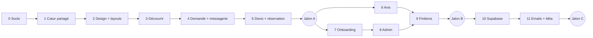

# Étape 4 : Découpage du MVP en lots

Marketplace de prestataires afro. Version 1, 22 novembre 2026.
S'appuie sur [les parcours](1-parcours-utilisateurs.md), [le modèle de données](2-modele-de-donnees.md) et [l'architecture](3-architecture-technique.md).

---

## 0. Le principe

On ne construit pas le MVP d'un bloc. On le découpe en **lots** : chaque lot est une petite tranche qui marche de bout en bout (données mockées → écran → tests), se termine par une ou quelques PR, et laisse l'application dans un état **démontrable**. Si tu t'arrêtes après n'importe quel lot, tu as quelque chose qui tourne.

Deux règles qui rendent ça possible :

1. **On construit « de bas en haut » dans chaque lot** : d'abord les schémas et règles dans `common` (avec leurs tests unitaires), puis les handlers MSW, puis les hooks TanStack Query, puis les écrans (avec leurs tests fonctionnels), et enfin un parcours Playwright.
2. **Une PR = un sujet**, idéalement moins de 400 lignes à relire. Un lot fait donc souvent 2 à 4 PR.

Rappel des décisions qui réduisent le périmètre :

| Décision                             | Ce qu'on **ne** construit **pas** au MVP                                                        |
| ------------------------------------ | ----------------------------------------------------------------------------------------------- |
| Devis plutôt que réservation directe | Pas de panier, pas de créneaux à réserver                                                       |
| Paiement hors plateforme             | Pas d'écrans paiement (C5), revenus (S9), litiges (A5). Le champ `paymentMode = offline` suffit |
| Gratuit pour les prestataires        | Pas d'abonnement (S11), pas de mise en avant payante                                            |
| Une demande = un prestataire         | Pas de multi-envoi                                                                              |
| Île-de-France                        | Pas de carte (P3) au MVP, la ville + le rayon suffisent                                         |

---

## 1. Vue d'ensemble

| Lot | Nom                                                | Écrans (codes de l'étape 1)   | Taille estimée                       |
| --- | -------------------------------------------------- | ----------------------------- | ------------------------------------ |
| 0   | Socle du monorepo + CI                             | Un écran d'accueil provisoire | S (fait dans la PR d'initialisation) |
| 1   | Cœur partagé : schémas, règles, base mockée        | Aucun                         | M                                    |
| 2   | Design system, layouts, connexion de démo          | P8 (démo)                     | M                                    |
| 3   | Découvrir : accueil, recherche, catégories, profil | P1, P2, P4, P5                | L                                    |
| 4   | Demander un devis + messagerie                     | C1, C2, C3, C4, S3, S5        | L                                    |
| 5   | Devis et réservation                               | S4, C3 (suite), S2, S6        | L                                    |
| 6   | Avis                                               | C6, S8                        | S                                    |
| 7   | Onboarding et profil prestataire                   | P6, S1, S7                    | L                                    |
| 8   | Admin minimal                                      | A2, A3, A4                    | M                                    |
| 9   | Compte, pages statiques, finitions                 | C8, P7, 404, SEO              | M                                    |
| 10  | Brancher le vrai back-end (Supabase)               | Aucun nouvel écran            | L                                    |
| 11  | Emails et lancement bêta                           | Aucun nouvel écran            | M                                    |

S = quelques jours, M = environ une semaine, L = une à deux semaines, en temps partiel. C'est indicatif : le vrai rythme se verra au lot 3.

**Trois jalons :**

- 🎯 **Jalon A, démo cliquable (après le lot 5)** : on cherche un prestataire, on demande un devis, il répond, on accepte. Tout est mocké, mais tu peux le montrer à de futurs prestataires pour les convaincre.
- 🎯 **Jalon B, MVP mocké complet (après le lot 9)** : tous les écrans MVP existent, testés, déployés sur une URL de prévisualisation (Vercel ou Netlify).
- 🎯 **Jalon C, bêta réelle (après le lot 11)** : vrais comptes, vraies données, quelques dizaines de prestataires d'Île-de-France invités.

Les lots 6 et 7 sont indépendants : on peut les faire dans l'ordre qu'on veut.

---

## 2. Le détail des lots

Pour chaque lot : ce qu'on construit, les règles métier concernées (numéros de la section 8 de l'étape 2), les tests attendus, et la définition de « terminé ».

### Lot 0 : Socle du monorepo + CI

**But** : un dépôt où l'on peut coder, tester et livrer sereinement.

- pnpm workspaces + Turborepo ; `apps/web`, `packages/common`, `packages/config`
- TypeScript strict, ESLint, Prettier partagés
- Vite + React + Tailwind + **shadcn/ui** + Motion (le nouveau nom de Framer Motion) + React Router + TanStack Query
- Premiers composants shadcn/ui (Button, Card, Badge, Skeleton) reliés aux couleurs de la marque
- MSW branché dans le navigateur (via `VITE_USE_MOCKS`) et dans les tests
- Premiers types Zod (catégories, origines, carte prestataire), `formatPrice`, quelques prestataires mockés
- Un écran d'accueil provisoire qui affiche les prestataires mis en avant
- Vitest (unitaires + un test fonctionnel), Playwright (un test), CI GitHub Actions

**Terminé quand** : `pnpm install && pnpm test` passe, la CI est verte, `pnpm dev` affiche l'accueil avec des données mockées.

👉 C'est l'objet de la PR d'initialisation.

### Lot 1 : Cœur partagé (schémas, règles, base mockée)

**But** : tout le modèle de l'étape 2 existe en code, testé, sans aucun écran.

- Un schéma Zod par entité MVP : User, ProviderProfile, Category, CulturalOrigin, Offering, Media, Unavailability, QuoteRequest, Quote, QuoteLine, Booking, Conversation, Message, Review, Report, ModerationAction (on laisse Payment, Dispute, Favorite pour plus tard)
- Les schémas des **formulaires** (`createQuoteRequestInputSchema`…)
- Les règles métier en fonctions pures : n° 1, 2, 3, 4, 6, 7, 8, 9 (la n° 5 « accepter un devis » arrive au lot 5)
- L'interface `ApiClient` complète (les signatures, pas encore toutes implémentées)
- `mocks/seed.ts` : ≈ 25 prestataires d'Île-de-France réalistes, 3 comptes de démo, des demandes dans chaque statut
- `mocks/db.ts` : la base en mémoire (avec persistance `localStorage` facultative et réinitialisation)

**Tests** : unitaires sur chaque règle avec cas limites, et sur les schémas (une demande sans date est refusée, budget max < min refusé…). Objectif de couverture élevé sur `rules/`.

**Terminé quand** : toutes les règles ont leurs tests, le seed passe la validation Zod.

### Lot 2 : Design system, layouts et connexion de démo

**But** : la « coque » de l'application, avant les vraies pages.

- Thème Tailwind définitif : couleurs, typographie, espacements (à faire avec une première identité visuelle, même provisoire)
- Composants UI de base avec **shadcn/ui** (ajoutés au fur et à mesure avec `pnpm dlx shadcn add …`, copiés dans `apps/web/src/components/ui`) : Input, Select, Dialog, Tabs, Avatar, DropdownMenu, Form, Calendar ; plus quelques composants maison (Rating, EmptyState). shadcn/ui s'appuie sur Radix UI, donc l'accessibilité (clavier, lecteurs d'écran) est gérée
- Les 4 layouts : public, espace client, espace pro (menu latéral), admin
- Routeur complet avec pages vides chargées à la demande, et les **gardes** de routes (connecté, rôle)
- Session dans Zustand ; page de connexion **de démo** avec les 3 comptes (« Aïssatou, cliente », « Saveurs de Dakar, prestataire », « Admin ») et redirection `?retour=`
- Bascule de rôle client ↔ prestataire pour les comptes à deux rôles

**Tests** : fonctionnels sur les gardes (non connecté → redirigé vers `/connexion` puis renvoyé à la bonne page). Playwright : connexion avec chaque compte de démo.

### Lot 3 : Découvrir (accueil, recherche, catégories, profil)

**But** : un visiteur trouve un prestataire et le consulte. C'est la vitrine.

- **P1 Accueil** : recherche « Quoi / Où / Quand », catégories, prestataires mis en avant, « comment ça marche »
- **P2 Résultats** : filtres catégorie, origine, ville, date (règle n° 3), budget, invités, note, vérifié ; tri ; filtres stockés dans l'URL ; pagination ou « voir plus »
- **P4 Page catégorie** (`/categories/traiteurs`) : même composant que les résultats, avec un titre et un texte pour Google
- **P5 Profil prestataire** : couverture, infos, galerie (avec lightbox), formules et prix, disponibilités (calendrier simple en lecture), avis, bouton « Demander un devis »
- Animations Framer Motion : apparition des cartes, transitions de page (en respectant `prefers-reduced-motion`)

**Tests** : fonctionnels (cocher « Sénégal » filtre bien, liste vide affiche un message, erreur API affiche un message). Playwright : recherche → filtre → profil, en version bureau et téléphone.

### Lot 4 : Demander un devis + messagerie

**But** : le client contacte un prestataire, la conversation s'ouvre des deux côtés.

- **C1 Formulaire de demande** (React Hook Form + Zod) : type d'événement, date, ville, invités, budget, particulier/pro, message. Si non connecté : connexion de démo puis retour au formulaire
- Règles n° 3 (prestataire indisponible) et n° 4 (pas de demande à soi-même)
- **C2 / C3** côté client : mes demandes (onglets en cours / réservations / terminées), détail avec statut
- **S3** côté prestataire : demandes reçues, détail, actions « Poser une question » et « Décliner » (avec motif)
- **C4 / S5 Messagerie** (composant partagé) : liste des conversations, fil, envoi, compteur de non-lus, rafraîchissement toutes les 5 à 10 s, **masquage des téléphones et emails** (règle n° 7), bouton « Signaler »
- Expiration automatique des demandes à 7 jours (simulée dans la base mockée)

**Tests** : fonctionnels (formulaire vide → erreurs ; rempli → redirection vers la conversation ; numéro masqué). Playwright : parcours 1 de l'étape 3 (visiteur → demande envoyée) et parcours 7 (masquage).

### Lot 5 : Devis et réservation

**But** : la boucle complète. À la fin de ce lot, on atteint le **jalon A**.

- **S4 Créer un devis** : lignes (libellé, quantité, prix unitaire), total calculé, acompte, validité, conditions ; nouvelle version d'un devis après négociation
- Côté client (C3) : voir le devis, **accepter** ou refuser. Règle n° 5 : accepter passe les autres versions en `superseded`, crée la réservation, bloque la date, poste un message système
- La réservation révèle l'adresse et lève le masquage des coordonnées
- Annulation (règle n° 9, même si en mode `offline` il n'y a pas de remboursement à calculer : on affiche les conditions)
- **S2 Tableau de bord prestataire** : demandes récentes, prochaines dates, 3 chiffres simples
- **S6 Agenda simple** : vue mois, dates réservées, blocage manuel de dates, réglage « max par jour »
- Passage automatique `confirmed → completed` après la date (simulé)

**Tests** : unitaires sur la règle n° 5 et le calcul du total. Playwright : parcours 2 et 3 de l'étape 3.

### Lot 6 : Avis

- **C6 Laisser un avis** : note, sous-notes, commentaire (photos en V2). Bouton visible seulement si la règle n° 6 le permet
- Affichage sur le profil, recalcul de la note moyenne (règle n° 8)
- **S8 Avis reçus** : liste, réponse publique unique, signalement

**Tests** : fonctionnels (pas de bouton sans réservation terminée). Playwright : parcours 4.

### Lot 7 : Onboarding et profil prestataire

- **P6 Devenir prestataire** : page d'argumentaire (gratuit au lancement !)
- **S1 Onboarding en étapes**, reprenable (`onboardingStep`) : type et SIRET facultatif, catégories et origines, zone, présentation et galerie, formules, disponibilités, politique d'annulation. Transitions animées entre étapes
- Règle n° 2 : envoi en validation seulement si le profil est complet
- **S7 Modifier mon profil + prévisualisation**, mise en pause

Upload de photos : au MVP mocké, on garde les images en mémoire (URL locales). Le vrai stockage arrive avec Supabase au lot 10.

**Tests** : fonctionnels par étape (validation des champs). Playwright : parcours 5.

### Lot 8 : Admin minimal

- **A2 Prestataires en attente** : fiche, valider / demander des corrections / refuser (avec motif)
- **A3 Signalements** : masquer un contenu, suspendre un compte
- **A4 Utilisateurs** : recherche, fiche, suspension
- Journal `ModerationAction` écrit à chaque action

Pas d'effort de design : des tableaux propres suffisent.

**Tests** : Playwright parcours 6 (l'admin valide → le profil apparaît dans la recherche).

### Lot 9 : Compte, pages statiques, finitions

- **C8 Mon compte** : profil, préférences de notification, **suppression du compte** (obligatoire RGPD : anonymisation)
- **P7** : comment ça marche, FAQ, CGU, mentions légales, politique de confidentialité (textes à faire relire)
- Page 404, états d'erreur globaux
- SEO de base : titres et descriptions par page, `sitemap`, données structurées sur les profils
- Accessibilité : passage d'audit (contraste, clavier, lecteurs d'écran)
- Déploiement d'une URL de prévisualisation par PR (Vercel ou Netlify, mocks activés)

**Terminé quand** : les 8 parcours Playwright de l'étape 3 passent. C'est le **jalon B**.

### Lot 10 : Brancher le vrai back-end (Supabase)

- Création du projet Supabase : tables issues du modèle de l'étape 2, règles d'accès (Row Level Security)
- Authentification réelle (email + Google ; Apple plus tard, utile surtout pour le mobile)
- Stockage des photos
- Une nouvelle implémentation de l'`ApiClient` pour Supabase. **Les écrans ne changent pas** : c'est tout l'intérêt de l'architecture
- Messagerie en temps réel avec Supabase Realtime (remplace le rafraîchissement toutes les 5 s)
- Les tâches automatiques (expiration des demandes, passage en `completed`) deviennent des tâches planifiées

### Lot 11 : Emails et lancement bêta

- Emails transactionnels : nouvelle demande, nouveau devis, nouveau message, réservation confirmée, rappel J-1, invitation à laisser un avis, profil validé
- Suivi d'audience respectueux du RGPD (Plausible ou équivalent) et suivi des erreurs (Sentry)
- Nom de domaine, nom de la marque (remplacer `@afro/…`)
- Inviter les premiers prestataires d'Île-de-France, recueillir les retours. C'est le **jalon C**.

---

## 3. Après le MVP (dans l'ordre probable)

1. **Application mobile** (Expo + NativeWind + Moti) : espace client + gestion des demandes côté prestataire. Elle réutilise tout `common`.
2. **Paiement en ligne** avec Stripe Connect : acompte, solde, versements, commission ; écrans C5, S9, A5 et litiges.
3. Favoris (C7), vue carte (P3), statistiques prestataire (S10).
4. Réservation directe pour les formules à prix fixe.
5. Mise en avant payante, multi-envoi de demandes, clients professionnels (factures).

---

## 4. Comment on travaille, lot par lot

- Chaque lot démarre par une **issue GitHub** qui reprend sa section de ce document (case à cocher par écran).
- Une branche par PR, nommée `feat/lot-3-recherche-filtres` par exemple.
- Une PR n'est fusionnée que si la CI est verte (lint, types, tests, build, Playwright).
- À la fin de chaque lot, une démo rapide sur l'URL de prévisualisation, et on ajuste la suite si besoin. Ce découpage n'est pas gravé dans le marbre.
